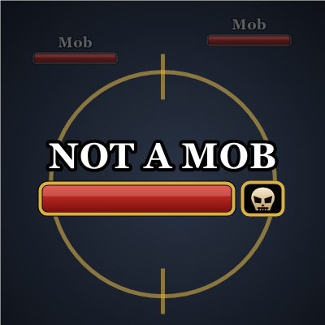
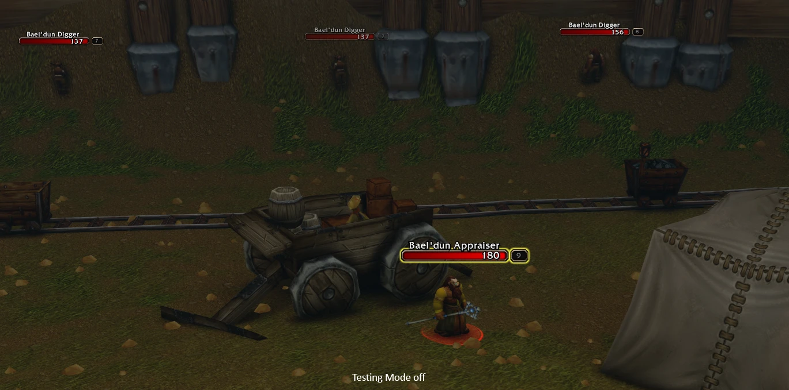
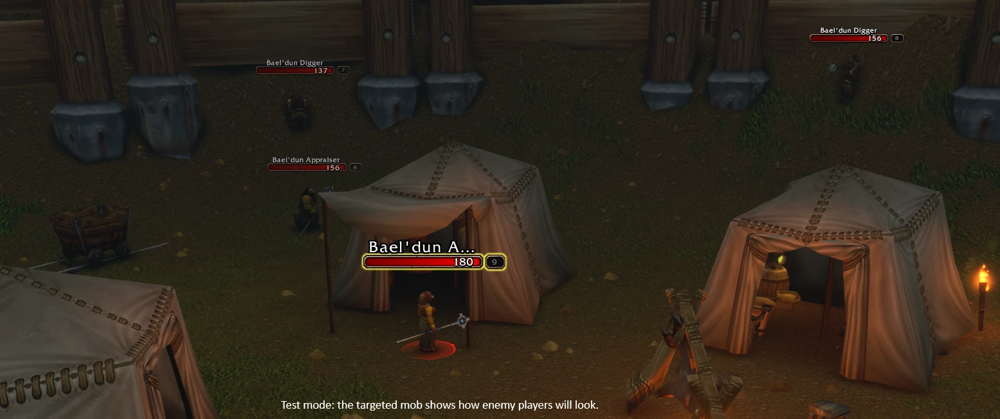
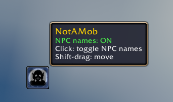
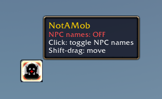

# NotAMob

In WoW Forever, enemy players and mobs both show up as red names at a distance, and I couldn't tell which was which.  So I made NotAMob.

It does two things:

1. Adds a small button (Hunter's Mark icon) that hides all NPC names.  Click it and every
   red name you can still see is a player, at any distance.  Click again and your NPC names
   come back the way you had them, so you can keep questing.
2. Makes enemy player names on nameplates bigger and outlined, so they stand out from mobs
   once they're in nameplate range.  Mobs and everything else stay Blizzard default.

| Without NotAMob | With NotAMob (test mode on a mob) |
|---|---|
|  |  |

| NPC names on | NPC names off |
|---|---|
|  |  |

## Install

**CurseForge app:** pick World of Warcraft, switch the game version to Forever, search for
NotAMob and hit Install.

**Wago app:** select WoW Forever, search for NotAMob and install it.

**WowUp:** pick your Forever install, search for NotAMob under Get Addons and install it.

**Manually:** download the zip and drop the `NotAMob` folder into
`World of Warcraft\_forever_\Interface\AddOns\`, then restart the game.

For the bigger names you need enemy nameplates on (V).  For the button to make sense, make
sure Enemy Players is ticked under Options > Interface > Names.

## Usage

Click the button to toggle NPC names, and shift-drag to move it.

- `/nam` opens the options
- `/nam help` lists the commands

NotAMob doesn't touch your game settings unless you click something that obviously does
(the toggle, the range button).  The nameplate font change isn't saved, so turning the addon
off puts everything back.  If you uninstall it while NPC names are hidden, they stay hidden
until you turn them back on in Options > Interface > Names.

## Support

NotAMob is free and always will be.  If it earned you some honor and you want to say thanks,
you can [buy me a coffee on Ko-fi](https://ko-fi.com/shenglong).

## P.S.

If you're the kind of player who stops mid-quest to screenshot a sunset over Stranglethorn,
NotAMob might have a little something for you.  It's not in the options and it's not in
`/nam help`.  Nine out of ten photographers would find it.  Probably.

## License

Copyright (c) 2026 Sheng Long.  All rights reserved.

You can use it, read the code and change your own copy for personal use.  Please don't
re-upload or redistribute it, modified or not, without asking me first.  Full terms in
[LICENSE](LICENSE).
